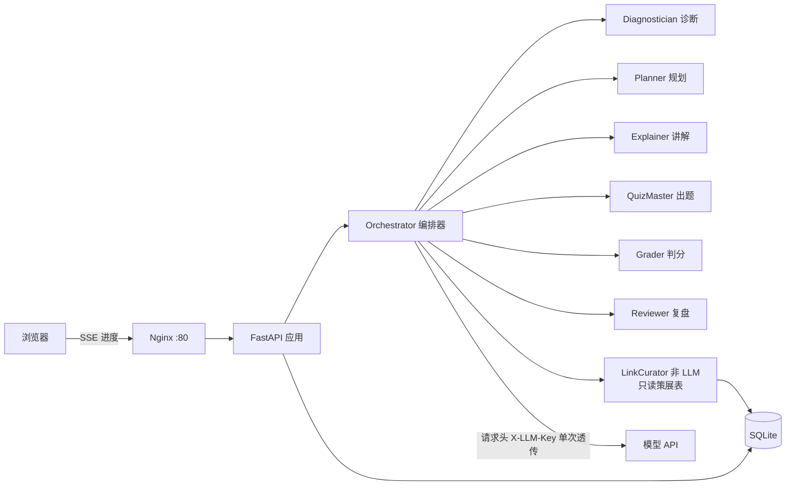
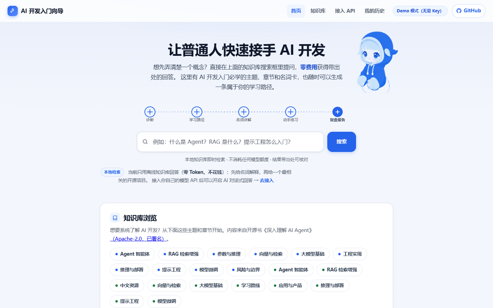
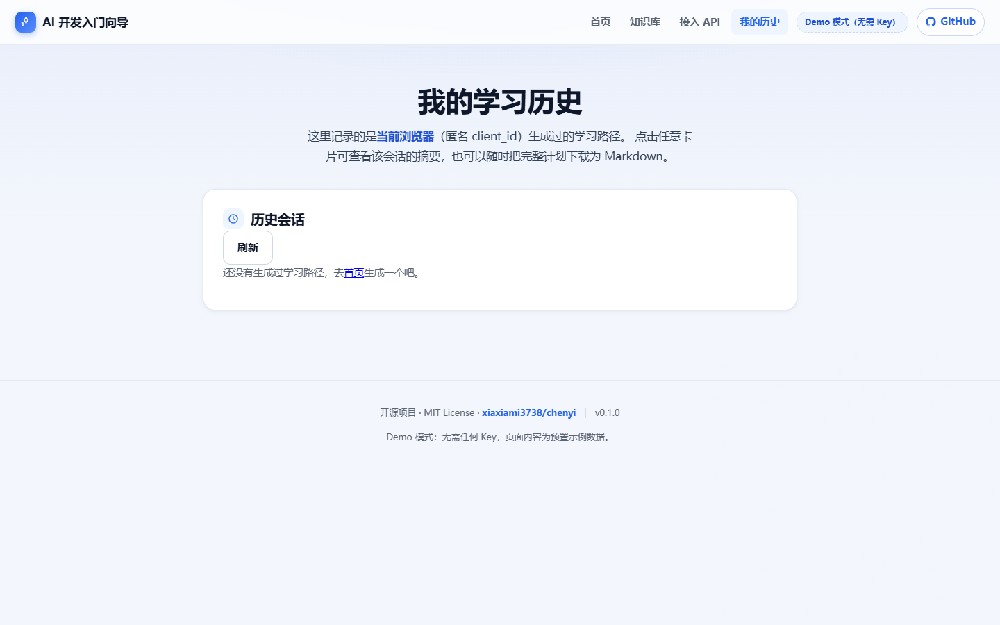

# chenyi · AI 开发入门向导

> 让普通人快速接手 AI 开发：说出你的目标，走完 **诊断 → 学习路径 → 名词讲解 → 动手练习 → 复盘报告** 一圈，每一步都附上人工挑选的开源项目链接。

面向零基础与转行者。不堆术语，不假装你懂，先用大白话把名词讲明白，再让你照着别人的真实项目动手。

---

## 它解决什么问题

- **名词爆炸**：RAG、Embedding、LoRA、Agent、Function Calling……查一个词会遇到三个新词。
- **路径缺失**：网上教程从"安装 CUDA"开始，转行者不知道先学什么。
- **不知道自己哪里不会**：没有诊断、没有练习、没有复盘，学完就忘。
- **不敢看源码**：最好的教材其实是别人的真实项目，缺的是一个"看哪几个"的清单。

## 核心特性

| 特性 | 说明 |
| --- | --- |
| 多 Agent 闭环 | 诊断 → 规划 → 讲解 → 出题 → 判分 → 复盘，每一步独立、可校验、可降级 |
| 名词卡 | 用类比讲清 AI 开发术语，并给出常见误区 |
| 动手练习 | 选择/填空/简答三类题；客观题规则判分，简答题按评分要点判分 |
| 手工策展链接 | 只推荐人工审核过的 GitHub 项目；**模型不允许生成 URL**（防幻觉、防钓鱼） |
| 知识库检索问答 | 离线开源书《深入理解 AI Agent》（Apache-2.0 已署名）+ 术语卡 + 策展链接，本地检索**零 Token** 带出处回答 |
| 角色「鲸小鱼」 | 傲娇深海鲸鱼娘人格：陪聊、叫访客「主人」、用尾巴动作表达情绪；本地模式给预设台词（零 Token），接入自己的模型 API 后自由对话 |
| BYOK | 访客自带模型 Key，站点不提供、不保存；Key 只在浏览器与单次请求里存在 |
| 服务端加密代存（可选） | 真实模式 + HTTPS 下可把 Key 用服务器主密钥（Fernet）加密保存，之后免填生成；只存密文不落明文 |
| Demo 模式 | 没有任何 Key 也能完整跑通流程，方便部署验证与演示 |
| 匿名可用 | 无需登录，用浏览器本地 `client_id` 归集历史，可导出 Markdown |

## 架构



- 编排器是**自研轻量实现**（asyncio + Pydantic 结构化输出），不引入重型框架：
  MVP 没有循环图、人工介入、检查点恢复的需求，而自研实现能对每一步做 schema 校验、重试与降级，并且能用 FakeLLM 整体测试。
- 讲解与出题对同一天并行执行（`asyncio.gather` + 信号量限流）。

## 快速开始（本地 Demo）

```bash
python -m venv .venv
. .venv/Scripts/activate        # Linux/macOS: source .venv/bin/activate
pip install -r requirements.txt -r requirements-dev.txt

cp .env.example .env            # 默认 APP_MODE=demo，无需任何 Key
uvicorn app.main:app --reload
```

打开 http://127.0.0.1:8000 。

跑测试与静态检查：

```bash
ruff check .
pytest -q
```

## 配置

全部来自环境变量，详见 [`.env.example`](.env.example)：

| 变量 | 默认 | 说明 |
| --- | --- | --- |
| `APP_MODE` | `demo` | `demo` 使用预置内容；`live` 走访客自带 Key |
| `DB_PATH` | `data/app.db` | SQLite 路径 |
| `RATE_LIMIT_PER_MINUTE` | `10` | 每 IP 每分钟生成次数上限 |
| `MAX_CONCURRENCY` | `2` | 同时进行的模型调用数上限 |
| `REQUEST_TIMEOUT_SECONDS` | `120` | 单次上游模型调用超时 |
| `MAX_INPUT_CHARS` | `8000` | 用户输入长度上限 |
| `VAULT_MASTER_KEY` | 空 | **可选**：服务端加密代存的主密钥（任意长随机串）。留空则代存功能关闭，纯浏览器 BYOK 不受影响 |

> 项目**不允许**任何形式的 `api_key` 环境变量。这是设计约束，并有测试守着（`tests/unit/test_no_key_storage.py`）。

## BYOK 与密钥安全

1. Key 只存在于**访客浏览器**的 `localStorage`；
2. 生成时通过请求头 `X-LLM-Key` 单次透传，服务端只在内存中使用，**不落库、不写文件**；
3. 访问日志经过 `app/llm/redact.py` 正则脱敏（`sk-…`、`Bearer …`、`X-LLM-Key` 一律替换为 `***`）；
4. 自定义 `baseURL` 只允许 `https://`（本机 Ollama 例外），并阻断内网地址（防 SSRF）；
5. 站点未启用 HTTPS 时，前端显著提示"不要填写生产 Key"。

### 服务端加密代存（M7.3，可选）

- 面向"不想每次填 Key"的访客：在**真实模式（APP_MODE=live）+ HTTPS** 下勾选「服务端加密代存」，把 Key 加密保存到服务器，之后生成学习路径时勾选「使用我已保存到服务器的 Key」即可免填；
- 落库的只有 Fernet 密文（`cipher_blob`），主密钥来自环境变量 `VAULT_MASTER_KEY`，**绝不明文写库、不进 Settings、不打日志**；更换主密钥后旧密文将无法解密（对应接口给出手动重新保存的提示）；
- 安全门控：Demo 模式 → 403；未配置主密钥 → 503；非 HTTPS → 403；
- 代存表 `vault_entries` 是唯一例外表，列名刻意避开凭证字面命名，并有测试守着（`tests/unit/test_no_key_storage.py` 显式开白 + 列白名单断言）。

### 角色人格：鲸小鱼（M9）

- 人格定义集中在 `app/services/persona.py`：`SYSTEM_PROMPT` 规定身份、称呼（「主人」）、尾巴动作、禁胖梗、全程中文、不用 emoji，并禁止涉及成人/敏感内容；
- `POST /api/chat`（`app/api/chat.py`）：Demo 模式返回**确定性预设台词**（`scripted_reply`，零 Token、可测试）；真实模式必须携带 Key（请求头 `X-LLM-Key` 或加密代存的 Key），用访客自己的额度，服务端不落库；
- 前端卡片 `#xiaoyu-card`（首页「知识库浏览」之后）：本地开场白、气泡最多保留 12 条、30s 超时、错误走傲娇话术；
- 形象素材在 `app/static/img/whale-xiaoyu-*.png`（AI 生图的二创设定，白底 + `mix-blend-mode: multiply` 融入页面）。

## 反向代理与流式输出

`deploy/nginx.conf` 中 `/api/` 关闭了 `proxy_buffering`，否则 SSE 逐字输出会被 Nginx 缓冲成一整段。

## 部署

```bash
# 服务器上（首次）
git clone https://github.com/xiaxiami3738/chenyi.git /srv/chenyi
bash /srv/chenyi/deploy/deploy.sh
```

- `deploy/docker-compose.yml`：`app`（FastAPI）+ `nginx`（80/443），SQLite 数据挂在宿主 `data/`
- `deploy/Dockerfile`：`python:3.12-slim`，非 root 运行，带 `/api/healthz` 健康检查
- `deploy/nginx.conf`：SSE 友好、限流、安全响应头；域名与证书就绪后取消注释 443 段即可启用 HTTPS

当前 MVP 直接用服务器 IP 访问（`http://<服务器IP>`），不依赖域名，也不需要备案；
拿到域名后再做解析、备案与证书，代码无需改动（前端全部使用相对路径）。

## 目录结构

```
app/
  api/         HTTP 路由（元信息 / 生成 / 作答 / 复盘 / 知识库检索 / 代存）
  agents/      六个角色的 Agent 实现
  llm/         模型客户端、供应商预设、脱敏、FakeLLM
  models/      SQLAlchemy 数据模型
  services/    业务服务（会话、链接、判分、限流、知识库、代存）
  prompts/     提示词模板（版本化）
  templates/   Jinja2 页面
  static/      原生 JS + CSS
data/kb/        本地知识库（开源书 Markdown + LICENSE + 署名）
data/seed/     人工策展数据（术语表、GitHub 链接清单）
tests/         unit / integration（FakeLLM，不依赖真实 Key）
e2e/           Playwright 端到端测试
deploy/        Dockerfile / compose / nginx / 部署脚本
```

## 测试策略

- **单元**：URL 白名单与防 SSRF、密钥脱敏、限流、判分规则、提示词组装；
- **集成**：`TestClient` + `FakeLLM` + 临时 SQLite，覆盖完整闭环、失败注入（429/超时/坏 JSON）、降级、Demo 模式，以及"模型输出的 URL 必须被忽略"；
- **E2E**：Playwright 以 Demo 模式启动真实服务，走完页面主流程；
- CI 中**不配置任何真实 Key**，因此测试永远确定性、不花钱。

## 路线图

- [x] M0 骨架：配置、数据模型、健康检查、Demo 开关、策展链接接口、CI
- [x] M1 模型抽象层 + FakeLLM + SSE 流水线（编排：diagnose→plan→逐天 explain/quiz→finalize，AgentRun 持久化，策展链接模糊匹配挂接）
- [x] M2 六个 Agent 拆分为独立积木角色 + 结果校验重试（app/agents/ 六角色，validator 校验失败重试 1 次，error_code=invalid_output 中止会话）
- [x] M3 前端两页 + 匿名历史 + Markdown 导出（首页生成 / history 页历史列表 + 一键下载）
- [x] M4 集成 / E2E 全覆盖（限流、脱敏、防幻觉断言）
- [x] M5 GitHub Actions 自动部署（push main 即 SSH 部署到 ECS）
- [x] M6 README / 架构图 / 演示截图 / 策展数据扩充（51 条链接 + 22 条术语）
- [x] M7 知识库检索问答 + 首页查询浏览改版 + 服务端加密 Key 代存（可选）+ 自动 git 习惯
- [x] M8 前端视觉改版（蓝色学习工作台：统一图标、焦点态、窄屏适配）
- [x] M9 首页本地问答 + `/kb` 知识库分页 + `/connect` 接入页 + 鲸小鱼人格与对话 + 二创形象

## 演示截图

> Demo 模式，无任何 LLM Key，公网实机截图。

| 首页（生成学习路径） | 我的历史页（匿名会话 + 导出） |
| --- | --- |
|  |  |

## 在线演示

- 公网地址：`http://118.178.182.215/`（Demo 模式，无需 Key）
- 部署方式：GitHub Actions push 自动部署（Docker Compose：FastAPI + Nginx，`deploy/deploy.sh`）

## 贡献

欢迎补充策展链接与术语卡：请只提交你**实际读过**的项目，并在 `why` 里写清"新手该看它的哪一部分"。

## License

[MIT](LICENSE)